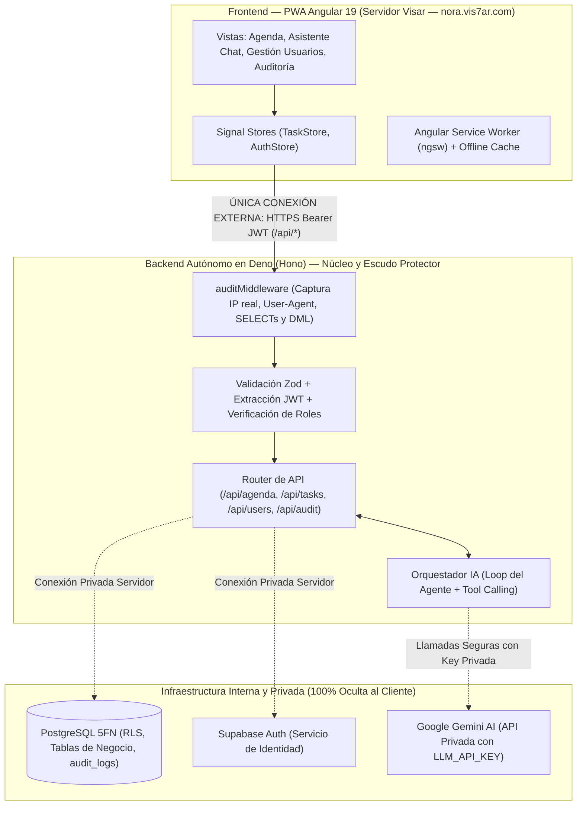
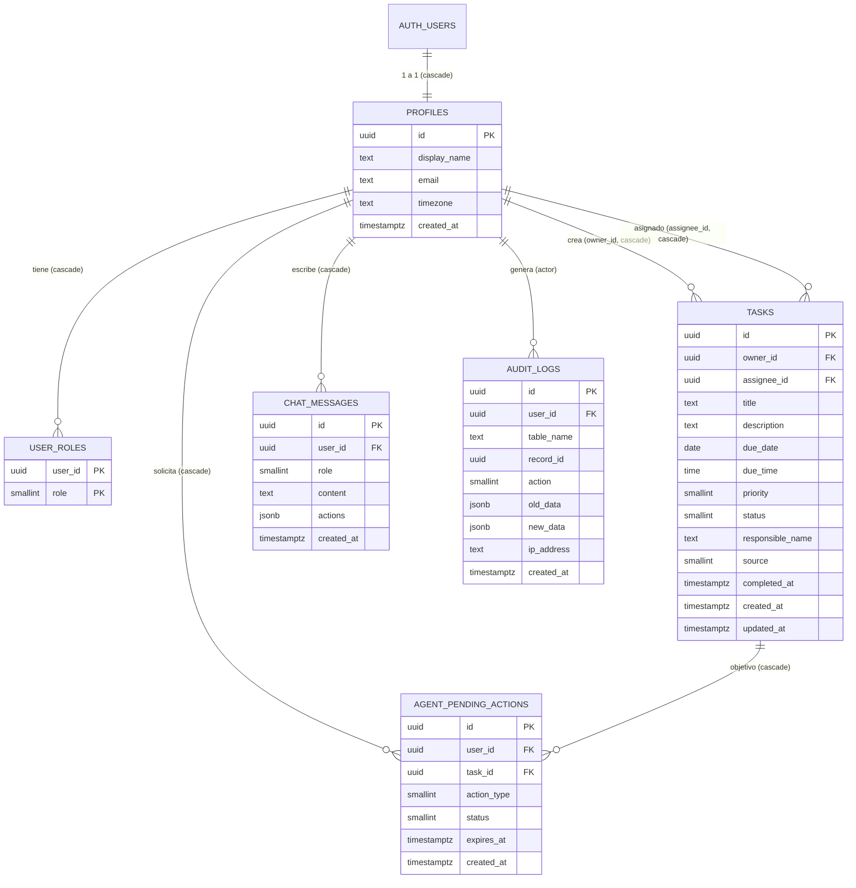
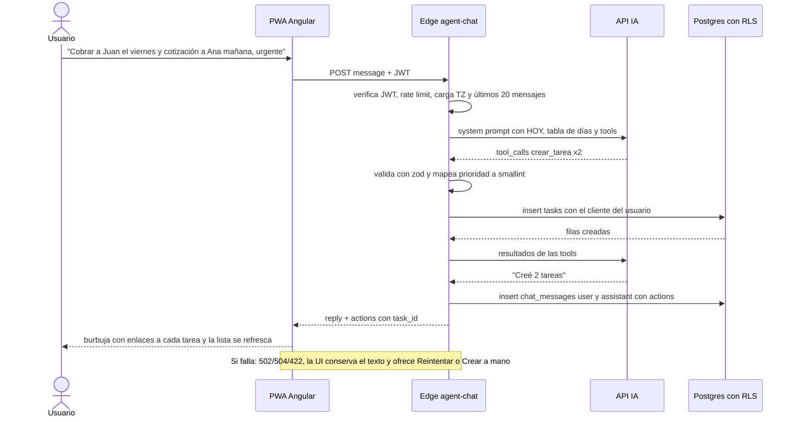
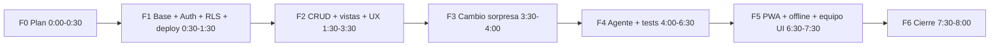

# Documento de Análisis Técnico y Plan de Ejecución — Prueba 1: Asistente de Tareas con IA (PWA)

> Fuente: `Prueba1_Asistente_Tareas_con_IA.md` (19-nov-2026). Time-box: **8 h** (incluye 30 min de plan).

---

## 1. Resumen Ejecutivo y Restricciones Críticas

### 1.1 Objetivo (≤3 líneas)
PWA móvil donde un usuario escribe pendientes en lenguaje natural ("cobrarle a Juan el viernes y la cotización a Ana mañana, urgente") y un **agente de IA con tool calling** crea, consulta y modifica tareas en **Supabase Cloud**. Los datos quedan aislados por usuario con RLS y la app se publica en producción en el servidor de pruebas Visar (`https://nora.vis7ar.com`) con Nginx nativo sin Docker.

### 1.2 Restricciones

| Tipo | Restricción | Fuente |
|---|---|---|
| Tiempo | 8 h máximo; 30 min iniciales de plan; cambio sorpresa a las 3:30 h | Reglas |
| Stack obligatorio | **Supabase Cloud (Postgres 5FN + Auth + Edge Functions con Hono)**; frontend Angular 19 PWA | Reglas, Definición |
| Seguridad | La llave de IA **nunca** en el navegador → Edge Function/backend (RF-28) | Reglas, RF-28 |
| Seguridad | RLS: A no ve ni modifica tareas de B, **ni llamando la API directamente** (RF-03) | RF-03 |
| Auditoría | Desacoplada en la capa de aplicación con **middleware en Hono** (`auditMiddleware`) con `EdgeRuntime.waitUntil()`; **cero triggers SQL** de auditoría para evitar contención y permitir auditar `SELECT` con IP/User-Agent | Decisión Arq |
| Arquitectura IA | El modelo **no escribe** en la BD; el backend ejecuta y valida cada herramienta (RF-14) | RF-14 |
| IA | Proveedor: Claude, OpenAI o Gemini | Reglas |
| Despliegue Frontend | Servidor Visar Ubuntu (`159.203.103.8`, `vis7ar.com`) con Nginx puro (0 Docker) en `https://nora.vis7ar.com`, con SSL Certbot, probada en celular real | RF-27, DevOps |
| Despliegue Backend | Script automatizado `deploy-backend.ps1`: ejecuta migraciones pendientes (`supabase db push`), soporta ejecución condicional de seeds idempotentes (`-WithSeed`) y publica Edge Functions | DevOps, RF-29 |
| Código | Git con commits frecuentes; esquema SQL versionado que recrea las tablas desde cero (RF-29) | Reglas, RF-29 |
| Zona horaria | Por defecto `America/Santo_Domingo` (UTC-4, sin horario de verano) | RF-19 |
| Alcance | "Menos y funcionando" > "mucho a medias"; lo no hecho va al README | Reglas |

### 1.3 Decisión de stack y arquitectura visual (ADR-01)
- **Frontend:** Angular 19 (Standalone + Signals + OnPush + Tailwind CSS) configurado como PWA instalable con tema oscuro nativo estilo *Google Calendar Mobile*.
  - **Patrón Visual de Agenda:** Selector superior de vistas (**Día**, **Semana**, **Mes**), barra superior con buscador, selector rápido de fecha, avatar del usuario y **filtro por usuario** (exclusivo para rol Supervisor/Admin).
  - **Orquestación Centrada en el Asistente IA:** Se **elimina el botón manual de agregar (+)** en la pantalla de Agenda. La creación y agendamiento de tareas se canaliza de forma natural a través del **Asistente IA Nora** (accesible desde el header y la barra inferior), el cual analiza la disponibilidad del usuario y propone **múltiples opciones de horarios libres** para seleccionar con un toque.
  - **Ficha Estándar y Trazabilidad Detallada:** Formato unificado de visualización de tareas con botón **"Ver información detallada"** para inspeccionar: quién la creó, fecha/hora exacta de creación, origen/canal (Asistente IA vs Manual), dispositivo/IP y última actualización.
  - **Módulo de Gestión de Usuarios:** CRUD completo para el Supervisor con drill-down a las tareas del colaborador (ver, editar y eliminar con confirmación modal). Cascada estricta: si se elimina un usuario, se eliminan todas sus tareas y mensajes asociados.
  - **Paquete Oficial de Iconos Nora:** Catálogo tipado de iconos SVG (`nora-spark`, `calendar-agenda`, `users-group`, `shield-audit`, `clock-time`, `check-task`, `info-detail`, `trash-delete`, `filter`, `mic-voice`) diseñados con el ADN del logo (trazos limpios, geometría moderna, acentos azul/violeta y destello IA).
- **Backend en Deno como Núcleo Autónomo y Escudo Protector (BFF):**
  - **Cero Exposición de Supabase:** El frontend Angular **nunca se comunica directamente con Supabase (ni PostgREST ni DB)**. No se exponen credenciales de base de datos ni endpoints de Supabase al cliente. Supabase queda restringido como nuestra infraestructura privada de persistencia.
  - **Backend Deno (Hono Framework):** Actúa como la única puerta de enlace autorizada (`https://nora.vis7ar.com/api/...`). Es el único componente que:
    1. Intercepta todas las llamadas con `auditMiddleware` (captura IP real, User-Agent, consultas `SELECT` y mutaciones `DML` sin triggers en PostgreSQL).
    2. Aplica validación estricta con Zod, resuelve roles y políticas de negocio.
    3. Se comunica privadamente con PostgreSQL en 5FN y Supabase Auth mediante conexión de servidor segura.
    4. Orquesta privadamente al agente de IA con **Google Gemini**, ejecutando el catálogo de herramientas (*Tool Calling*).
    5. Permite diversificar y escalar nuevos servicios (webhooks, reportes, microservicios futuros) sin alterar la base de datos ni depender de la UI de Supabase.
  - **Despliegue Cohesionado en Servidor Visar (0 Docker):** En el servidor Ubuntu de Visar (`159.203.103.8`, `vis7ar.com`), Nginx sirve los estáticos de la PWA Angular en `/` y enruta transparentemente las peticiones `/api/*` hacia el backend en Deno, unificando todo bajo el dominio seguro `https://nora.vis7ar.com` con SSL Certbot.
  - **Pipeline Backend con Migraciones y Seeds Controlados:** Script `deploy-backend.ps1` que aplica automáticamente las migraciones DDL/DML pendientes en Postgres mediante `supabase db push`, soporta la inyección controlada de semillas idempotentes (`-WithSeed` vía `supabase db execute --file ./supabase/seed.sql` con `ON CONFLICT DO NOTHING`), y publica las funciones y servicios de Deno.
- **Auditoría Desacoplada por Middleware (Sin Triggers SQL):**
  - Se sustituyen los triggers `tg_audit_log` de PostgreSQL por un **middleware en la capa de aplicación (`auditMiddleware` en Hono)**.
  - Permite auditar tanto mutaciones (`INSERT`, `UPDATE`, `DELETE`) como lecturas sensibles (`SELECT`), enriquecidas con metadatos HTTP reales (`ip_address`, `user_agent`, `duration_ms`).
  - Escritura asíncrona no bloqueante mediante `EdgeRuntime.waitUntil()` para no penalizar la latencia del usuario final.
  - Interfaz de consulta de auditoría en la app **exclusiva para Supervisor/Admin**, con **filtro por usuario** y **paginación server-side**.
- **Auth/JWT:** `supabase-js` con persistencia de sesión y paso del token JWT con UUID del usuario en cada petición para resolver roles, menús y RLS.
- **Enums:** `smallint` enteros fijos con constraints `CHECK`. Conversión a contratos legibles en DTOs.

### 1.4 Criterios de evaluación / éxito
1. Base de datos y seguridad (RLS verificable con 2 usuarios y llamadas REST directas).
2. Experiencia móvil y PWA (360 px, instalable, offline básico, estados de carga/vacío/error).
3. Agente con herramientas (multi-tarea, fechas relativas correctas, sin alucinar, pregunta ante ambigüedad, confirma lo destructivo).
4. Criterio para priorizar (plan, MVP, manejo del cambio sorpresa, README honesto).
5. Comunicación (preguntas al evaluador, commits, video, revisión en vivo de 20 min).

---

## 2. Matriz de Trazabilidad y Priorización

### 2.1 Bloque A — Alcance Crítico (MVP / Obligatorios)

| ID | Módulo | Requerimiento | Riesgo | Dependencias |
|---|---|---|---|---|
| RF-01 | Auth | Registro/login email+password (Supabase Auth) | Bajo | — |
| RF-02 | Auth | Rutas protegidas (redirige a login) | Bajo | RF-01 |
| RF-03 | Seguridad/BD | Aislamiento por usuario con RLS (también vía API directa) | **Alto** | RF-01, RF-29 |
| RF-05 | Tareas | Crear tarea manual (título, descripción, fecha, prioridad, responsable, estado) sin recargar | Bajo | RF-03 |
| RF-06 | Tareas | Vistas Hoy / Próximas / Vencidas / Completadas | Medio (TZ) | RF-05, RF-19 |
| RF-07 | Tareas | Editar y eliminar (con confirmación); persiste | Bajo | RF-05 |
| RF-08 | Tareas | Cambio de estado con un toque (optimista) | Bajo | RF-05 |
| RF-10 | Tareas | Validación con errores junto al campo | Bajo | RF-05 |
| RF-12 | Agente | Chat en lenguaje natural crea tarea con título y fecha correctos | Medio | RF-14, RF-19, RF-28 |
| RF-13 | Agente | Varias tareas en un mensaje + prioridad alta si es "urgente" | Medio | RF-12 |
| RF-14 | Agente | Tool calling: `crear_tarea`, `listar_tareas`, `actualizar_tarea`, `completar_tarea`; el backend valida y ejecuta | **Alto** | RF-28, RF-03 |
| RF-15 | Agente | Consultas con datos reales, sin inventar | Medio | RF-14 |
| RF-16 | Agente | Modificar por chat; si hay ambigüedad (2 tareas de Juan) pregunta | **Alto** | RF-14, RF-15 |
| RF-17 | Agente | Confirmación antes de eliminar; resumen "Creé 2 tareas" con enlaces | Medio | RF-14 |
| RF-18 | Agente | Errores de IA: mensaje claro, conserva el texto, reintentar o crear a mano | Medio | RF-12, RF-05 |
| RF-19 | Agente/Core | Fechas relativas en la TZ del usuario (también cerca de medianoche) | **Alto** | — |
| RF-22 | UI | Mobile-first 360 px, botones táctiles ≥44 px, sin scroll horizontal | Bajo | — |
| RF-23 | PWA | Manifest (nombre, íconos 192/512, theme_color), standalone | Bajo | RF-27 (HTTPS) |
| RF-24 | PWA | Service worker: offline muestra las últimas tareas + aviso "sin conexión" | Medio | RF-06, RF-23 |
| RF-25 | UI | Estados de carga, vacío y error en todas las pantallas | Bajo | Todas las vistas |
| RF-27 | DevOps | URL pública funcional desde un celular real desplegada en Servidor Visar (`https://nora.vis7ar.com`) con Nginx puro (0 Docker) y Supabase Cloud | Medio | — |
| RF-28 | Seguridad | Llaves de IA fuera del navegador | Medio | Edge Function |
| RF-29 | DevOps/BD | Esquema versionado (migraciones Supabase CLI sobre Supabase Cloud) | Bajo | — |
| CS-01 | Sorpresa | Rol supervisor: ve todo, asigna a otros, filtra por persona (ver §5.4) | **Alto** | RF-03, RF-05 |
| RF-UI-CAL | UI / Agenda | Vistas de Calendario Día, Semana y Mes con grid y pills; **sin botón ADD** en agenda (creación orquestada por IA) | Medio | RF-06, RF-22 |
| RF-AI-MULTI | Agente | Sugerencia de **múltiples bloques horarios libres** en agenda para confirmar hora con un solo toque | Medio | RF-12, RF-19 |
| RF-TASK-STD | Tareas | Ficha estándar de tareas con botón **"Ver información detallada"** (creador, hora/fecha, origen IA/manual y última actualización) | Bajo | RF-05, RF-07 |
| RF-USR-CRUD | Admin | Módulo CRUD de Gestión de Usuarios para Supervisor (con vista de tareas por usuario, edición y borrado en cascada con confirmación modal) | Medio | RF-03, CS-01 |
| RF-AUDIT | Seguridad/BD | Tabla e histórico `audit_logs` **solo para Admin**, con **filtro por usuario**, **paginación** y registro de mutaciones y lecturas vía **Middleware en Hono (0 triggers)** | Medio | RF-03, RF-29 |
| RF-ICONS | UI | Paquete de 10 iconos oficiales Nora SVG tipados en `ICON_CATALOG` (`IconRegistryService`) | Bajo | RF-22 |

### 2.2 Bloque B — Alcance Secundario (Deseables / Post-MVP), en orden de valor/costo

| Orden | ID | Módulo | Requerimiento | Riesgo | Dependencias | Justificación |
|---|---|---|---|---|---|---|
| 1 | RF-30 | Calidad | ≥3 pruebas automáticas (fechas + validadores de herramientas) | Bajo | RF-14, RF-19 | Barato y respalda el criterio "agente". **Se hace dentro de la Fase 4** |
| 2 | RF-20 | Agente | Historial de conversación persistido | Bajo | `chat_messages` | La tabla ya existe por el contexto del agente; costo marginal |
| 3 | RF-04 | Auth | Perfil con nombre visible en el encabezado | Bajo | `profiles` | El trigger ya crea el perfil; 10 min |
| 4 | RF-09 | Tareas | Filtros combinables + búsqueda de texto | Bajo | RF-06 | Parte se reutiliza en el "filtrar por persona" del cambio sorpresa |
| 5 | RF-21 | Agente | Dictado por voz (Web Speech API) | Medio (soporte iOS) | RF-12 | Vistoso pero no funciona en todos los navegadores |
| 6 | RF-11 | Tareas | Etiquetas/proyectos | Medio | RF-05 | Nueva tabla N:M + UI |
| 7 | RF-26 | PWA | Notificaciones push por vencer | **Alto** | VAPID, cron, SW | Requiere `pg_cron` + Web Push; iOS solo si la PWA está instalada. Se descarta primero |

---

## 3. Ambigüedades y Preguntas de Clarificación

| # | Tema | Pregunta al evaluador / Decisión de Diseño | Solución adoptada |
|---|---|---|---|
| Q1 | "Responsable" y Roles (RF-05) | ¿Es texto libre o usuario del sistema? | Se manejan **dos roles** vinculados al `user_id` (UUID): **Miembro** y **Supervisor/Admin**. Todas las peticiones validan el UUID para determinar permisos y navegación |
| Q2 | Menú según Rol | ¿Cómo se estructura la navegación? | Según el rol del UUID: **Miembro** accede al menú **"Agenda"** (sus tareas). **Supervisor** accede a **"Agenda"** + **"Gestión de Usuarios"** (visión global del equipo y asignación) |
| Q3 | Fecha límite y Horarios libres (RF-19) | ¿Cómo mitigar errores en fechas relativas ("mañana", "el viernes")? | **Confirmación multi-horario según horas libres:** El agente no agenda a ciegas ni impone una hora fija; consulta la agenda del día destino y ofrece **múltiples opciones de horas libres** (chips interactivos como `[10:00 AM]`, `[11:30 AM]`, `[04:00 PM]`) para que el usuario confirme con un toque |
| Q4 | "El viernes" dicho un viernes | ¿Es hoy o el próximo viernes? | El **próximo** viernes (+7). La confirmación de horario despeja cualquier ambigüedad |
| Q5 | Cerca de medianoche | A las 00:30, ¿"mañana" es el día calendario siguiente? | Sí: calendario estricto en la TZ del usuario (`Intl` + TZ del perfil, no UTC) |
| Q6 | Tareas sin fecha | ¿En qué vista aparecen? | En "Próximas", al final, con la etiqueta "Sin fecha" |
| Q6 | Reglas de vistas | ¿Una tarea hecha y con fecha de hoy aparece en "Hoy"? | Hecha → **solo** Completadas. Hoy = `due_date = hoy` y no hecha. Vencidas = `due_date < hoy` y no hecha. Próximas = `due_date > hoy` o sin fecha, y no hecha |
| Q7 | Prioridad por defecto | Si el mensaje no indica prioridad... | `media`. "urgente", "ya", "importante", "lo antes posible" → `alta`. "cuando puedas", "sin prisa" → `baja` |
| Q8 | Eliminar por chat | RF-17 pide eliminar por chat, pero RF-14 no lista `eliminar_tarea`. ¿Se agrega? | Sí, se agrega `eliminar_tarea`, que **no borra**: crea una acción pendiente que el usuario confirma con un botón (endpoint aparte) |
| Q9 | Borrado | ¿Físico o lógico? | Físico tras confirmar (MVP). Soft-delete queda en el backlog |
| Q10 | Historial | ¿Una conversación por usuario o varias? | Un solo hilo por usuario; al agente se le envían los últimos 20 mensajes |
| Q11 | Supervisor: alcance | ¿Puede editar o borrar tareas ajenas? ¿Quién lo designa? ¿El asignado puede editar? | El supervisor ve todo, asigna, edita y cambia estado; **no borra** tareas ajenas. Se designa por SQL/seed (sin UI de administración). El asignado ve la tarea y cambia su estado; editar y borrar le toca al creador |
| Q12 | Supervisor y agente | ¿El agente del supervisor consulta las tareas de todo el equipo? | Sí, porque respeta RLS. `listar_tareas` recibe `alcance: "mias" \| "equipo"` (por defecto `"mias"`) |
| Q13 | Confirmación de email | ¿Se desactiva para facilitar la prueba? | Se desactiva "Confirm email" en Supabase Auth y se documenta en el README |
| Q14 | Zona horaria editable | ¿El usuario puede cambiar su TZ? | `profiles.timezone` con valor por defecto `America/Santo_Domingo`; sin UI en el MVP. El cliente envía `Intl...timeZone` como pista y gana el perfil |
| Q15 | Idioma | ¿Solo español? | Sí: prompt y UI en español (es-DO) |
| Q16 | Costos/abuso | ¿Hay límite de uso de la IA? | Rate limit simple: 20 mensajes/min por usuario (conteo en `chat_messages`); mensajes de máx. 2 000 caracteres |
| Q17 | Offline: escrituras | ¿Se puede crear o editar sin red? | No. Offline = solo lectura (lo que pide RF-24); botones de escritura y chat deshabilitados con aviso |

---

## 4. Diseño de Arquitectura y Modelo de Datos

### 4.1 Componentes y responsabilidades



| Capa | Responsabilidad | Notas de seguridad / Aislamiento |
|---|---|---|
| **Frontend Angular 19** | UI, validación UX (Reactive Forms), Signal Stores, renderizado de calendario, offline cache | **Cero contacto directo con Supabase ni con APIs de IA**. Solo conoce `/api/...` de nuestro backend. Desplegado en Visar (`nora.vis7ar.com`). |
| `core/` | `ApiService` (Base HTTP hacia `/api`), `AuthService` (signals de sesión), `authGuard`/`roleGuard`, `DateService` (TZ), `NetworkStatusService`, `AuditService` | Sin dependencias directas de SDKs que expongan la infraestructura. |
| `shared/` | `<app-icon>`, `ui-empty-state`, `ui-error-state`, `ui-skeleton`, `confirm-dialog` (confirmación destructiva modal), `field-error` | Componentes reutilizables 100% standalone. |
| `layout/` | `AppShell` (header con selector temporal, buscador, avatar, toggle de vistas Día/Semana/Mes, filtro por usuario para Admin, Bottom-Nav / Menú: Agenda / Gestión de Usuarios*), `OfflineBanner` | *Gestión de Usuarios solo visible para Admin/Supervisor. |
| `features/` | `auth`, `agenda` (calendario Día/Semana/Mes, grid con pills de tareas, filtros), `users-admin` (CRUD usuarios + vista de tareas por usuario + borrado en cascada), `assistant` (chat IA con tool calling), `audit` (visitas y mutaciones solo Admin) | Módulos desacoplados sin imports cruzados. |
| **Backend Deno (Hono Framework)** | **Escudo Protector, Orquestador y Núcleo de Auditoría**. Expone la API unificada `/api/*`, ejecuta `auditMiddleware` con `EdgeRuntime.waitUntil()`, orquesta el agente de Google Gemini, valida esquemas con Zod y gestiona Supabase privadamente. | **Cero triggers en BD**. Permite diversificar servicios (webhooks, reportes, integraciones) sin exponer la BD. |
| **Supabase Cloud (Privado)** | Persistencia relacional en 5FN, políticas RLS, constraints de integridad, cascada `ON DELETE CASCADE`. | Accedido **exclusivamente** por nuestro Backend en Deno. Completamente invisible para el navegador. |
| **Google Gemini API (Privado)** | Procesamiento de lenguaje natural, razonamiento y selección de herramientas (*Function Calling*). | Invocado **únicamente** por el backend con la `LLM_API_KEY` almacenada en secretos de servidor. |

### 4.1.1 Especificación Visual y de Interacción (Basada en Mockup)

```mermaid
flowchart TD
  subgraph Header["Barra Superior Dinámica"]
    Nav["☰ Menú / Logo"] --- MonthSel["Noviembre ▼"] --- Search["🔍 Buscador"] --- Today["[19] Ir a Hoy"] --- Avatar["👤 Avatar"]
    ViewSwitch["Selector de Vista: [ Día | Semana | Mes ]"]
    AdminUserFilter["Filtro de Usuario (Solo Admin): [ Todos los usuarios ▼ ]"]
    AiShortcut["✨ Acceso Directo Asistente Nora"]
  end
  subgraph MainView["Vista Principal — Agenda / Calendario (Sin botón manual ADD)"]
    Grid["Grid de Días (dom, lun, mar, mié, jue, vie, sáb)"]
    PillTasks["Pills de Tareas interactivas (Clic abre Ficha Estándar)"]
  end
  subgraph TaskStandardModal["Ficha Estándar de Tarea y Trazabilidad Detallada"]
    StdView["Vista Estándar: Título, Prioridad, Fecha, Hora sugerida y Asignado"]
    BtnDetail["Botón: [ ℹ️ Ver información detallada ]"]
    DetailPanel["Metadatos: Creador, Canal (IA vs Manual), Fecha/Hora exacta, Dispositivo y Última Actualización"]
    StdView --> BtnDetail --> DetailPanel
  end
  subgraph AIAssistant["Asistente IA Nora (Creación y Orquestación)"]
    Chat["Chat en Lenguaje Natural ('Cobrar a Juan el viernes...')"]
    MultiSlot["Sugerencia de Múltiples Horarios Libres: [ 10:00 AM ] [ 11:30 AM ] [ 04:00 PM ]"]
    Chat --> MultiSlot
  end
  subgraph AdminModule["Módulo de Gestión de Usuarios y Auditoría (Exclusivo Admin)"]
    UserList["Lista de Colaboradores (Nombre, Email, Rol, Tareas activas)"]
    AuditList["Auditoría Transaccional: Filtro por Usuario + Paginación Server-Side"]
    ModalConfirm["Modal de Confirmación Crítica: 'Borrar usuario eliminará TODAS sus tareas en cascada'"]
  end
```



- **Tema y Paleta:** Paleta dual (Modo Oscuro nativo de alto contraste y Modo Claro optimizado para lectura diurna) gobernada por tokens Tailwind CSS (ver detalle en §4.1.2).
- **Navegación y Vistas:**
  - Selector superior de granularidad temporal: **Día** (timeline con horas), **Semana** (7 columnas de lunes a domingo) y **Mes** (grid mensual completo como en el mockup adjunto).
  - Si el usuario logueado tiene rol **Supervisor/Admin**, se renderiza un combobox adicional en la barra superior para alternar entre "Mis Tareas", "Tareas de todo el equipo" o filtrar por un colaborador puntual.
- **Orquestación Centrada en IA (Sin botón manual ADD):**
  - Se suprime el botón flotante (+) en la agenda. La creación se orquesta desde el botón del Asistente en la barra superior o en el bottom-nav.
  - El asistente analiza la agenda y propone **múltiples opciones de horarios libres** (botones táctiles de selección rápida).
- **Ficha Estándar de Tareas y Trazabilidad Detallada:**
  - Al pulsar sobre cualquier tarea en la agenda o listas, se abre la **Ficha Estándar** (título, prioridad, fecha, hora y responsable).
  - Incluye el botón **"Ver información detallada"**, que despliega:
    - **Creada por:** Nombre y avatar del usuario creador (`owner_id` / `profiles.display_name`).
    - **Fecha y hora de creación:** Timestamp exacto (`created_at timestamptz`).
    - **Origen / Canal:** `source` (1 = Manual PWA, 2 = Asistente IA Chat en lenguaje natural).
    - **Dispositivo / Red:** IP y User-Agent capturados en el log de auditoría.
    - **Última actualización:** Timestamp y actor de la última mutación.
- **Módulo de Gestión de Usuarios (CRUD):**
  - Vista en tabla/cards con paginación y búsqueda.
  - Al seleccionar un usuario, el Supervisor puede consultar su listado de tareas asignadas, editarlas o reasignarlas.
  - **Borrado en Cascada con Confirmación Estricta:** La acción de borrar usuario despliega un modal con advertencia explícita: *"Esta acción es irreversible y eliminará al usuario junto con todas sus tareas, mensajes y asignaciones en cascada"*. Requiere confirmar ingresando la palabra clave o pulsando confirmación de doble paso.
- **Auditoría Transaccional Paginada (Solo Admin):**
  - Acceso restringido exclusivamente a supervisores vía guard de ruta y política RLS.
  - Controles de **filtro por usuario** y selector de operaciones (`INSERT`, `UPDATE`, `DELETE`, `SELECT`).
  - Barra de paginación (`PAGE_SIZE = 10, 25, 50`) con botones Anterior/Siguiente.

### 4.1.2 Identidad de Marca, Logotipo y Paleta de Estilos (Claro y Oscuro)

#### A. Concepto de Marca y Simbología
* **Nombre del Proyecto:** **Nora** (del árabe *Nūr* y raíz occitana *Eleonora*: *"Luz"*, *"Claridad"*, *"Guía"*).
* **Propósito Visual:** Nora es el faro inteligente que transforma el ruido caótico de los chats cotidianos en claridad operativa estructurada.
* **Morfología del Logotipo:**
  * **Monograma "N":** Dos columnas estructurales (compromisos y ejecución) unidas por una cinta dinámica en diagonal que representa la automatización fluida de flujos de trabajo.
  * **Chispa de Inteligencia Artificial (✦):** Estrella de cuatro puntas en el vértice superior derecho del isotipo, evocando el destello cognitivo del asistente IA al comprender contexto y lenguaje natural.
* **Activos Vectoriales y Render Generados:**
  * [nora-icon.svg](file:///c:/PROYECTOS/Nora/documentos/assets/nora-icon.svg): Isotipo vectorial escalable para PWA icons (192px, 512px) y favicon.
  * [nora-logo-horizontal.svg](file:///c:/PROYECTOS/Nora/documentos/assets/nora-logo-horizontal.svg): Logotipo con isotipo + wordmark para header de navegación y pantalla de login.
  * [nora-logo.jpg](file:///c:/PROYECTOS/Nora/documentos/assets/nora-logo.jpg): Render 3D glassmorphic de alta fidelidad para splash screen y App Store.

#### B. Paleta de Colores Dual (Dark Mode & Light Mode)

La aplicación soporta alternancia automática según preferencias del sistema (`prefers-color-scheme`) y toggle manual persistido en `localStorage`.

| Token de Diseño | Modo Oscuro (Dark Theme - Primario) | Modo Claro (Light Theme) | Uso en la Aplicación |
|---|---|---|---|
| `--nora-bg-base` | `#0B0F19` (Obsidian Slate) | `#F8FAFC` (Slate 50) | Fondo principal / Canvas del viewport |
| `--nora-surface-card` | `#151D2C` (Deep Indigo Slate) | `#FFFFFF` (Pure White) | Tarjetas de tareas, celdas del calendario |
| `--nora-surface-elevated`| `#1E293B` (Slate 800) | `#FFFFFF` + `shadow-md` | Modales, Speed Dial FAB, Drawers |
| `--nora-border-subtle` | `#222F43` (Slate 750) | `#E2E8F0` (Slate 200) | Grillas de calendario, separadores |
| `--nora-primary` | `#2563EB` (Electric Royal Blue) | `#1D4ED8` (Deep Blue 700) | Botón FAB, acentos activos, tab seleccionado |
| `--nora-primary-hover` | `#3B82F6` (Blue 500) | `#1E40AF` (Blue 800) | Estados hover/active en controles primarios |
| `--nora-ai-spark` | `#A855F7` (Vivid Purple) | `#7C3AED` (Violet 700) | Destellos IA, burbujas del Asistente Nora |
| `--nora-ai-glow` | `#38BDF8` (Luminous Cyan) | `#0284C7` (Sky 600) | Badges de tool calling, chips de sugerencias |
| `--nora-text-primary` | `#F8FAFC` (Slate 50) | `#0F172A` (Slate 900) | Títulos, horas, contenido principal (WCAG AAA) |
| `--nora-text-muted` | `#94A3B8` (Slate 400) | `#64748B` (Slate 500) | Fechas secundarias, etiquetas, metadatos |
| `--nora-text-faint` | `#475569` (Slate 600) | `#94A3B8` (Slate 400) | Días fuera de mes, placeholders |

#### C. Código Cromático de Tareas y Estados (Pills de Agenda)

Para garantizar legibilidad instantánea en los modos Día, Semana y Mes, las pastillas (*pills*) de tareas utilizan un esquema de semáforo operativo de alta visibilidad:

| Entidad / Estado | Modo Oscuro (Fondo / Texto) | Modo Claro (Fondo / Texto) | Significado Visual |
|---|---|---|---|
| **Prioridad Alta (Urgente)** | `bg-red-950/80 text-red-200 border-red-800` (`#450A0A`) | `bg-red-50 text-red-700 border-red-200` | Requiere atención inmediata hoy |
| **Prioridad Media** | `bg-amber-950/70 text-amber-200 border-amber-800` (`#451A03`) | `bg-amber-50 text-amber-700 border-amber-200` | Tarea estándar programada |
| **Prioridad Baja** | `bg-blue-950/60 text-blue-200 border-blue-800` (`#172554`) | `bg-blue-50 text-blue-700 border-blue-200` | Pendiente sin urgencia estricta |
| **Estado Hecha / Completada** | `bg-emerald-950/60 text-emerald-300 line-through` | `bg-emerald-50 text-emerald-700 line-through` | Tarea finalizada |
| **Pill Informativa (Daily/Evento)**| `bg-cyan-950/60 text-cyan-200 border-cyan-800` (como en mockup) | `bg-cyan-50 text-cyan-700 border-cyan-200` | Actividades recurrentes de equipo |

#### D. Configuración de Tailwind CSS (`tailwind.config.js`)

```js
/** @type {import('tailwindcss').Config} */
module.exports = {
  darkMode: 'class',
  content: ['./src/**/*.{html,ts}'],
  theme: {
    extend: {
      colors: {
        nora: {
          bg: {
            dark: '#0B0F19',
            light: '#F8FAFC',
          },
          surface: {
            dark: '#151D2C',
            light: '#FFFFFF',
            elevatedDark: '#1E293B',
            elevatedLight: '#FFFFFF',
          },
          border: {
            dark: '#222F43',
            light: '#E2E8F0',
          },
          primary: {
            DEFAULT: '#2563EB',
            hover: '#1D4ED8',
            light: '#3B82F6',
          },
          ai: {
            spark: '#A855F7',
            glow: '#38BDF8',
          }
        }
      },
      boxShadow: {
        'nora-fab': '0 8px 24px -4px rgba(37, 99, 235, 0.45)',
        'nora-card-dark': '0 4px 16px -2px rgba(0, 0, 0, 0.35)',
      }
    }
  },
  plugins: [],
};
```

#### E. Paquete Oficial de Iconos Nora (SVG) y Repositorio Tipado Angular

Diseñados bajo la misma identidad visual del logotipo de Nora (geometría limpia, bordes suaves, trazos de 2px, acentos azul eléctrico y destellos de IA). Cumple estrictamente con el estándar de arquitectura frontend mediante `IconRegistryService` y `<app-icon name="..." />`:

| Nombre del Icono (`NoraIconName`) | Archivo SVG | Semántica y Uso en la Aplicación |
|---|---|---|
| `nora-spark` | [nora-spark.svg](file:///c:/PROYECTOS/Nora/documentos/assets/icons/nora-spark.svg) | Destello del Asistente IA, prompts inteligentes, chip de sugerencia |
| `calendar-agenda` | [calendar-agenda.svg](file:///c:/PROYECTOS/Nora/documentos/assets/icons/calendar-agenda.svg) | Vista de Agenda / Calendario (Día, Semana, Mes), selector de fecha |
| `users-group` | [users-group.svg](file:///c:/PROYECTOS/Nora/documentos/assets/icons/users-group.svg) | Módulo de Gestión de Usuarios, filtros de equipo (Admin) |
| `shield-audit` | [shield-audit.svg](file:///c:/PROYECTOS/Nora/documentos/assets/icons/shield-audit.svg) | Módulo de Auditoría Transaccional, indicador de seguridad RLS |
| `clock-time` | [clock-time.svg](file:///c:/PROYECTOS/Nora/documentos/assets/icons/clock-time.svg) | Sugerencia de bloques de horas libres, hora asignada de tarea |
| `check-task` | [check-task.svg](file:///c:/PROYECTOS/Nora/documentos/assets/icons/check-task.svg) | Tarea completada, toggle optimista de estado |
| `info-detail` | [info-detail.svg](file:///c:/PROYECTOS/Nora/documentos/assets/icons/info-detail.svg) | Botón "Ver información detallada", metadatos de creación |
| `trash-delete` | [trash-delete.svg](file:///c:/PROYECTOS/Nora/documentos/assets/icons/trash-delete.svg) | Acción de eliminar, confirmación de borrado en cascada |
| `filter` | [filter.svg](file:///c:/PROYECTOS/Nora/documentos/assets/icons/filter.svg) | Filtros de auditoría, filtros de tareas por estado/prioridad |
| `mic-voice` | [mic-voice.svg](file:///c:/PROYECTOS/Nora/documentos/assets/icons/mic-voice.svg) | Dictado por voz (Web Speech API) en la caja de chat |

##### Contrato Tipado en Angular (`core/icons/icon-catalog.ts`):
```ts
export type NoraIconName =
  | 'nora-spark'
  | 'calendar-agenda'
  | 'users-group'
  | 'shield-audit'
  | 'clock-time'
  | 'check-task'
  | 'info-detail'
  | 'trash-delete'
  | 'filter'
  | 'mic-voice';

export const NORA_ICON_CATALOG: Record<NoraIconName, string> = {
  'nora-spark': `<svg ...></svg>`,
  'calendar-agenda': `<svg ...></svg>`,
  'users-group': `<svg ...></svg>`,
  'shield-audit': `<svg ...></svg>`,
  'clock-time': `<svg ...></svg>`,
  'check-task': `<svg ...></svg>`,
  'info-detail': `<svg ...></svg>`,
  'trash-delete': `<svg ...></svg>`,
  'filter': `<svg ...></svg>`,
  'mic-voice': `<svg ...></svg>`,
};
```

### 4.2 ERD Actualizado con Auditoría y Cascada



### 4.3 Catálogo de enums (enteros fijos)

| Enum | Valores |
|---|---|
| `task_priority` | 1 = baja, 2 = media, 3 = alta |
| `task_status` | 1 = pendiente, 2 = en_progreso, 3 = hecha |
| `task_source` | 1 = manual, 2 = agente |
| `app_role` | 1 = miembro, 2 = supervisor |
| `chat_role` | 1 = user, 2 = assistant |
| `pending_action_type` | 1 = eliminar_tarea, 2 = eliminar_usuario |
| `pending_action_status` | 1 = pendiente, 2 = confirmada, 3 = cancelada, 4 = expirada |
| `audit_action` | 1 = INSERT, 2 = UPDATE, 3 = DELETE, 4 = SELECT (Lectura auditada) |

> Excepción gobernada de 5FN: `chat_messages.actions jsonb` y `audit_logs.old_data / new_data jsonb` (snapshots inmutables de auditoría transaccional).

### 4.4 Migración `supabase/migrations/0001_init.sql` (MVP)

```sql
create extension if not exists pg_trgm;

-- PROFILES
create table public.profiles (
  id            uuid primary key references auth.users(id) on delete cascade,
  display_name  text not null check (char_length(display_name) between 1 and 80),
  timezone      text not null default 'America/Santo_Domingo',
  created_at    timestamptz not null default now()
);

-- TASKS
create table public.tasks (
  id               uuid primary key default gen_random_uuid(),
  owner_id         uuid not null default auth.uid() references public.profiles(id) on delete cascade,
  title            text not null check (char_length(btrim(title)) between 1 and 200),
  description      text check (char_length(description) <= 2000),
  due_date         date,
  due_time         time,
  priority         smallint not null default 2 check (priority in (1,2,3)),
  status           smallint not null default 1 check (status in (1,2,3)),
  responsible_name text check (char_length(responsible_name) <= 80),
  source           smallint not null default 1 check (source in (1,2)),
  completed_at     timestamptz,
  created_at       timestamptz not null default now(),
  updated_at       timestamptz not null default now()
);
create index ix_tasks_owner_status_due on public.tasks (owner_id, status, due_date, due_time);
create index ix_tasks_title_trgm on public.tasks using gin (title gin_trgm_ops);

-- CHAT
create table public.chat_messages (
  id          uuid primary key default gen_random_uuid(),
  user_id     uuid not null default auth.uid() references public.profiles(id) on delete cascade,
  role        smallint not null check (role in (1,2)),
  content     text not null check (char_length(content) between 1 and 4000),
  actions     jsonb,
  created_at  timestamptz not null default now()
);
create index ix_chat_user_created on public.chat_messages (user_id, created_at desc);

-- AUDIT LOGS (Histórico transaccional desacoplado: poblado vía auditMiddleware en Edge Functions; CERO triggers en BD)
create table public.audit_logs (
  id          uuid primary key default gen_random_uuid(),
  user_id     uuid references public.profiles(id) on delete cascade,
  table_name  text not null,
  record_id   uuid,
  action      smallint not null check (action in (1,2,3,4)), -- 1=INSERT, 2=UPDATE, 3=DELETE, 4=SELECT
  old_data    jsonb,
  new_data    jsonb,
  ip_address  text,
  user_agent  text,
  created_at  timestamptz not null default now()
);
create index ix_audit_logs_user_table on public.audit_logs (user_id, table_name, created_at desc);
create index ix_audit_logs_created on public.audit_logs (created_at desc);

-- PENDING ACTIONS (confirmación de destructivas)
create table public.agent_pending_actions (
  id           uuid primary key default gen_random_uuid(),
  user_id      uuid not null default auth.uid() references public.profiles(id) on delete cascade,
  task_id      uuid not null references public.tasks(id) on delete cascade,
  action_type  smallint not null check (action_type in (1,2)), -- 1=eliminar_tarea, 2=eliminar_usuario
  status       smallint not null default 1 check (status in (1,2,3,4)),
  expires_at   timestamptz not null default now() + interval '10 minutes',
  created_at   timestamptz not null default now()
);
create index ix_pending_user_status on public.agent_pending_actions (user_id, status);

-- TRIGGERS DE NEGOCIO (Exclusivamente lógica de estado; la auditoría se gestiona en la capa de aplicación)
create or replace function public.tg_tasks_touch() returns trigger
language plpgsql as $$
begin
  new.updated_at := now();
  if new.status = 3 and (tg_op = 'INSERT' or old.status <> 3) then new.completed_at := now(); end if;
  if new.status <> 3 then new.completed_at := null; end if;
  if tg_op = 'UPDATE' and new.owner_id <> old.owner_id then
    raise exception 'owner_id es inmutable';
  end if;
  return new;
end $$;
create trigger trg_tasks_touch before insert or update on public.tasks
for each row execute function public.tg_tasks_touch();

create or replace function public.handle_new_user() returns trigger
language plpgsql security definer set search_path = '' as $$
begin
  insert into public.profiles (id, display_name)
  values (new.id, coalesce(nullif(new.raw_user_meta_data->>'display_name',''), split_part(new.email,'@',1)));
  return new;
end $$;
create trigger on_auth_user_created after insert on auth.users
for each row execute function public.handle_new_user();

-- RLS (MVP: solo dueño)
alter table public.profiles enable row level security;
alter table public.tasks enable row level security;
alter table public.chat_messages enable row level security;
alter table public.agent_pending_actions enable row level security;

create policy profiles_select_own on public.profiles for select to authenticated using (id = auth.uid());
create policy profiles_update_own on public.profiles for update to authenticated using (id = auth.uid()) with check (id = auth.uid());

create policy tasks_select_own on public.tasks for select to authenticated using (owner_id = auth.uid());
create policy tasks_insert_own on public.tasks for insert to authenticated with check (owner_id = auth.uid());
create policy tasks_update_own on public.tasks for update to authenticated using (owner_id = auth.uid()) with check (owner_id = auth.uid());
create policy tasks_delete_own on public.tasks for delete to authenticated using (owner_id = auth.uid());

create policy chat_select_own on public.chat_messages for select to authenticated using (user_id = auth.uid());
create policy chat_insert_own on public.chat_messages for insert to authenticated with check (user_id = auth.uid());

create policy pending_all_own on public.agent_pending_actions for all to authenticated
  using (user_id = auth.uid()) with check (user_id = auth.uid());

-- Hardening: anon no toca nada
revoke all on public.tasks, public.chat_messages, public.agent_pending_actions, public.profiles from anon;
```

### 4.5 Migración `0002_supervisor.sql` (cambio sorpresa — ver §5.4)

```sql
create table public.user_roles (
  user_id uuid not null references public.profiles(id) on delete cascade,
  role    smallint not null check (role in (1,2)),
  primary key (user_id, role)
);
alter table public.user_roles enable row level security;
create policy roles_select_own on public.user_roles for select to authenticated using (user_id = auth.uid());
-- sin políticas de insert/update/delete: solo SQL/service_role (evita autoescalada)

create or replace function public.is_supervisor() returns boolean
language sql stable security definer set search_path = '' as $$
  select exists (select 1 from public.user_roles where user_id = auth.uid() and role = 2);
$$;

alter table public.tasks add column assignee_id uuid references public.profiles(id) on delete cascade;
create index ix_tasks_assignee on public.tasks (assignee_id, status, due_date);

drop policy tasks_select_own on public.tasks;
drop policy tasks_update_own on public.tasks;
drop policy tasks_insert_own on public.tasks;
drop policy tasks_delete_own on public.tasks;

create policy tasks_select on public.tasks for select to authenticated
  using (owner_id = auth.uid() or assignee_id = auth.uid() or public.is_supervisor());
create policy tasks_insert on public.tasks for insert to authenticated
  with check (owner_id = auth.uid() and (assignee_id is null or assignee_id = auth.uid() or public.is_supervisor()));
create policy tasks_update on public.tasks for update to authenticated
  using (owner_id = auth.uid() or assignee_id = auth.uid() or public.is_supervisor())
  with check (owner_id = auth.uid() or assignee_id = auth.uid() or public.is_supervisor());
create policy tasks_delete on public.tasks for delete to authenticated
  using (owner_id = auth.uid() or public.is_supervisor());

-- Guarda: solo el supervisor reasigna a terceros; el asignado (no dueño) solo cambia status
create or replace function public.tg_tasks_guard() returns trigger
language plpgsql as $$
begin
  if new.assignee_id is distinct from old.assignee_id and not public.is_supervisor()
     and new.assignee_id is distinct from auth.uid() and new.assignee_id is not null then
    raise exception 'Solo un supervisor puede asignar a otros usuarios';
  end if;
  if old.owner_id <> auth.uid() and not public.is_supervisor()
     and (new.title, new.description, new.due_date, new.due_time, new.priority, new.responsible_name, new.assignee_id)
         is distinct from (old.title, old.description, old.due_date, old.due_time, old.priority, old.responsible_name, old.assignee_id) then
    raise exception 'El asignado solo puede cambiar el estado';
  end if;
  return new;
end $$;
create trigger trg_tasks_guard before update on public.tasks
for each row execute function public.tg_tasks_guard();

-- RLS DE GESTIÓN DE USUARIOS (CRUD para Supervisor)
create policy profiles_select_supervisor on public.profiles for select to authenticated using (public.is_supervisor());
create policy profiles_insert_supervisor on public.profiles for insert to authenticated with check (public.is_supervisor());
create policy profiles_update_supervisor on public.profiles for update to authenticated using (public.is_supervisor()) with check (public.is_supervisor());
create policy profiles_delete_supervisor on public.profiles for delete to authenticated using (public.is_supervisor());

-- RLS DE AUDITORÍA (Solo lectura para Supervisor; inserción desacoplada vía Edge Function/Service)
alter table public.audit_logs enable row level security;
create policy audit_select_supervisor on public.audit_logs for select to authenticated using (public.is_supervisor());
create policy audit_insert_authenticated on public.audit_logs for insert to authenticated with check (user_id = auth.uid() or public.is_supervisor());
revoke all on public.audit_logs from anon;

-- AUDITORÍA DESACOPLADA EN CAPA DE APLICACIÓN:
-- Los triggers nativos en PostgreSQL introducen contención de bloqueos y son ciegos a peticiones SELECT y metadatos HTTP.
-- La auditoría transaccional de Nora se gestiona íntegramente a través de `auditMiddleware` en Supabase Edge Functions (Hono).
```

### 4.6 Contratos de las Edge Functions (Hono Framework)

El backend serverless en **Supabase Cloud** se estructura con el framework **Hono** sobre Deno, ofreciendo enrutamiento ultraligero (<15 KB), tipado estricto y soporte nativo de middleware.

#### 4.6.1 Middleware de Auditoría Desacoplado (`audit.middleware.ts`)

Intercepta mutaciones (`POST`, `PUT`, `PATCH`, `DELETE`) y lecturas sensibles (`GET /tasks`, `GET /users`, etc.), capturando IP real y User-Agent sin bloquear la respuesta HTTP mediante `EdgeRuntime.waitUntil()`:

```ts
import { MiddlewareHandler } from 'https://deno.land/x/hono@v4.3.11/mod.ts';
import { createClient } from 'https://esm.sh/@supabase/supabase-js@2.45.4';

export const auditMiddleware = (): MiddlewareHandler => {
  return async (c, next) => {
    const startTime = Date.now();
    const method = c.req.method;
    const path = c.req.path;
    
    // Captura metadatos de red y cliente
    const ipAddress = c.req.header('x-forwarded-for')?.split(',')[0].trim() 
      || c.req.header('cf-connecting-ip') 
      || '127.0.0.1';
    const userAgent = c.req.header('user-agent') || 'Unknown';

    // Clonar body para auditoría en mutaciones
    let reqBody: any = null;
    if (['POST', 'PUT', 'PATCH'].includes(method)) {
      try { reqBody = await c.req.json(); } catch { /* ignore */ }
    }

    // Ejecuta el handler principal primero
    await next();

    // Mapeo semántico de acción según método HTTP (1=INSERT, 2=UPDATE, 3=DELETE, 4=SELECT)
    const actionMap: Record<string, number> = {
      POST: 1,
      PUT: 2,
      PATCH: 2,
      DELETE: 3,
      GET: 4,
    };
    const action = actionMap[method] || 4;

    // Solo auditar si la respuesta fue exitosa o relevante
    if (c.res.status >= 200 && c.res.status < 400) {
      const user = c.get('user'); // Extraído por authMiddleware
      if (user?.id) {
        // Ejecución en background no bloqueante (0 ms de latencia agregada)
        // @ts-ignore: EdgeRuntime disponible en Supabase Edge
        EdgeRuntime.waitUntil((async () => {
          const supabaseAdmin = createClient(
            Deno.env.get('SUPABASE_URL')!,
            Deno.env.get('SUPABASE_SERVICE_ROLE_KEY')!
          );

          await supabaseAdmin.from('audit_logs').insert({
            user_id: user.id,
            table_name: path.split('/')[2] || 'unknown',
            action: action,
            old_data: null, // poblado en updates específicos
            new_data: reqBody ? { payload: reqBody, status: c.res.status } : null,
            ip_address: ipAddress,
            user_agent: userAgent,
          });
        })());
      }
    }
  };
};
```

#### 4.6.2 Endpoints del Sistema

**`POST /functions/v1/agent-chat`** (Header `Authorization: Bearer <jwt>`)
```ts
// Request
type AgentChatRequest = {
  message: string;            // 1..2000 caracteres
  client_timezone?: string;   // pista IANA; gana profiles.timezone
};
// Response 200
type AgentChatResponse = {
  reply: string;                         // texto final del agente
  actions: Array<{
    type: 'created' | 'updated' | 'completed' | 'listed';
    task_id: string; title: string; due_date: string | null; due_time?: string | null;
  }>;
  suggested_time_slots?: Array<{         // Opciones múltiples de horas libres
    time: string;                        // "10:00 AM", "11:30 AM", "04:00 PM"
    recommended?: boolean;
    reason?: string;
  }>;
  pending_action?: { id: string; type: 'delete'; task_id: string; title: string; expires_at: string };
  needs_clarification?: { options: Array<{ task_id: string; title: string; due_date: string | null }> };
};
// Errores: 400 VALIDATION | 401 UNAUTHENTICATED | 429 RATE_LIMITED | 502 LLM_UNAVAILABLE | 504 LLM_TIMEOUT | 422 LLM_INVALID_OUTPUT
type AgentError = { error: { code: string; message: string; retryable: boolean } };
```

**`GET /functions/v1/tasks/:id/audit-detail`** (Inspección de Trazabilidad Estándar)
```ts
type TaskAuditDetailResponse = {
  id: string;
  title: string;
  priority: 1 | 2 | 3;
  status: 1 | 2 | 3;
  due_date: string | null;
  due_time: string | null;
  assignee: { id: string; display_name: string; email: string } | null;
  creator: { id: string; display_name: string; email: string };
  created_at: string;
  source: 'manual' | 'ai_assistant';
  source_channel: string;               // ej. "PWA Mobile (Chrome Android) • IP: 190.167.x.x"
  updated_at: string;
  last_updated_by?: { display_name: string };
  completed_at?: string | null;
};
```

**`POST /functions/v1/agent-confirm`**
```ts
type AgentConfirmRequest = { pending_action_id: string; decision: 'confirm' | 'cancel' };
type AgentConfirmResponse = { status: 'confirmed' | 'cancelled' | 'expired' | 'not_found'; task_id?: string };
```

### 4.7 Herramientas del agente (firmas exactas, JSON Schema)

| Herramienta | Parámetros de entrada | Salida (al modelo) | Validación en el servidor |
|---|---|---|---|
| `crear_tarea` | `{ titulo: string(1..200), descripcion?: string(≤2000), fecha_limite?: "YYYY-MM-DD", hora_asignada?: "HH:mm", prioridad?: "baja"\|"media"\|"alta", responsable?: string(≤80) }` | `{ ok: true, tarea: { id, titulo, fecha_limite, hora_asignada, prioridad, estado } }` | zod; fecha válida y ≥ hoy−1; prioridad media por defecto; `source=2` (IA) |
| `consultar_horas_libres` | `{ fecha: "YYYY-MM-DD", duracion_minutos?: number(15..120)=30 }` | `{ ok: true, fecha, bloques_libres: ["10:00 AM", "11:30 AM", "04:00 PM"] }` | Verifica tareas ya agendadas ese día y devuelve huecos disponibles para sugerir al usuario |
| `listar_tareas` | `{ estado?: "pendiente"\|"en_progreso"\|"hecha"\|"abiertas", desde?: "YYYY-MM-DD", hasta?: "YYYY-MM-DD", texto?: string, responsable?: string, alcance?: "mias"\|"equipo", limite?: int(1..50)=20 }` | `{ ok: true, total, tareas: [{ id, titulo, fecha_limite, hora_asignada, prioridad, estado, responsable }] }` | `desde ≤ hasta`; `alcance=equipo` solo si `is_supervisor()` |
| `actualizar_tarea` | `{ id: uuid, cambios: { titulo?, descripcion?, fecha_limite?, hora_asignada?, prioridad?, estado?, responsable? } }` (al menos 1 campo) | `{ ok: true, tarea }` \| `{ ok: false, error: "NOT_FOUND" }` | uuid válido; RLS decide si existe |
| `completar_tarea` | `{ id: uuid }` | `{ ok: true, tarea }` \| `{ ok: false, error }` | status=3 |
| `eliminar_tarea` *(Q8)* | `{ id: uuid }` | `{ ok: true, requiere_confirmacion: true, pending_action_id }` | **No borra**: inserta `agent_pending_actions` |

**Reglas anti-alucinación y anti-ambigüedad (en prompt + servidor):**
1. Las herramientas que modifican exigen `id` uuid, que el modelo solo puede obtener de `listar_tareas` (no hay "actualizar por texto").
2. Prompt: "Si `listar_tareas` devuelve más de 1 coincidencia, NO actúes: pregunta al usuario cuál, listando título y fecha". El servidor además devuelve `needs_clarification` para que la UI muestre opciones tocables.
3. Prompt: "Responde consultas SOLO con datos de herramientas; si no hay, di que no hay".
4. **Fechas (RF-19):** el servidor inyecta en el system prompt `HOY = 2026-11-19 (jueves), TZ = America/Santo_Domingo, hora local 23:52` y una **tabla de los próximos 14 días** (`vie 2026-11-20, sáb 2026-11-21…`) para que el modelo la busque en vez de calcular. El servidor rechaza fechas pasadas y devuelve el error al modelo para que corrija.
5. Loop máximo de 5 iteraciones de tool calls; timeout total de 25 s; temperatura 0–0.2.



### 4.8 Lógica de vistas y fechas (frontend `DateService`)
- `today = Temporal/Intl` en `profile.timezone` → `YYYY-MM-DD`.
- Hoy: `status≠3 ∧ due_date = today` · Vencidas: `status≠3 ∧ due_date < today` · Próximas: `status≠3 ∧ (due_date > today ∨ due_date is null)` · Completadas: `status=3` (ordenadas por `completed_at desc`).
- Se recalcula con un `signal` de reloj cada 60 s y al volver a la app (`visibilitychange`), por si se cruza la medianoche.

### 4.9 Offline (RF-24)
- `ngsw-config.json`: `assetGroups` con prefetch del app shell e íconos. **No** se cachean respuestas de Supabase en el SW (llevan JWT y podrían mezclar sesiones).
- `TaskStore` guarda un snapshot en IndexedDB (`localforage`) con la clave `tasks:<user_id>` y lo hidrata si `navigator.onLine === false` o falla el fetch. Se borra en el logout.
- `NetworkStatusService` (signal) → `OfflineBanner` "Sin conexión — mostrando últimas tareas cargadas"; formularios y chat deshabilitados.

---

## 5. Estrategia de Ejecución por Fases

### 5.1 Roadmap



| Fase | Ventana | % | Entregables | RF | Commit(s) clave |
|---|---|---|---|---|---|
| F0 Plan | 0:00–0:30 | 6 % | Plan de 1 página, preguntas Q1–Q17 enviadas, repo Git + proyecto Supabase Cloud configurado | — | `chore: init repo y plan` |
| F1 Base | 0:30–1:30 | 12.5 % | Angular 19 + Tailwind + supabase-js; login/registro/logout; guards; `0001_init.sql`; **deploy esqueleto en Servidor Visar con Nginx nativo** (`https://nora.vis7ar.com`, de-risk RF-27); prueba RLS con 2 usuarios vía `curl` | 01, 02, 03, 29, 27 | `feat(auth)`, `feat(db): init + RLS` |
| F2 Tareas | 1:30–3:30 | 25 % | Form con validación; lista con 4 vistas (tabs); toggle de estado optimista con rollback; editar/eliminar con confirmación; skeleton/vacío/error; mobile 360 px; snapshot IndexedDB | 05–08, 10, 22, 25, (24 parcial) | `feat(tasks): ...` (3–5 commits) |
| F3 Sorpresa | 3:30–4:00 | 6 % | Estimación y respuesta escrita al evaluador; `0002_supervisor.sql` + seed; filtro `assignee`/owner en la lista; selector de asignado en el form (solo supervisor) | CS-01 | `feat(db): supervisor + assignee` |
| F4 Agente | 4:00–6:30 | 31 % | Edge `agent-chat` con Hono (adaptador LLM, tools, zod, loop, rate limit); `agent-confirm`; `auditMiddleware` no bloqueante con `EdgeRuntime.waitUntil()`; UI chat con burbujas, enlaces, opciones de desambiguación, confirmación, errores con reintento/"crear a mano" prellenado; historial; **3+ tests Deno** (fechas, validadores) | 12–20, 28, 30 | `feat(agent): ...` |
| F5 PWA | 6:30–7:30 | 12.5 % | Manifest + íconos 192/512 (+maskable), ngsw, banner offline; prueba en Android/iOS real; vista "Equipo" para supervisor si quedó pendiente; nombre en el header | 23, 24, 27, 04 | `feat(pwa)` |
| F6 Cierre | 7:30–8:00 | 6 % | README (setup, decisiones, ADRs, lo que quedó fuera), 2 usuarios + 1 supervisor, video 3–5 min | Entregables | `docs: README` |

**Orden de recorte si hay desvío:** RF-26 → RF-11 → RF-21 → RF-09 (búsqueda) → UI "Equipo" dedicada (se queda el filtro en la lista) → RF-20 (UI del historial). **Nunca se recorta:** RLS, la validación de herramientas en el servidor, el manejo de errores de IA ni el deploy.

### 5.1.1 Estrategia de Despliegue DevOps (Servidor Visar — 0 Docker)

Para garantizar un entorno de producción ultraligero y de mantenimiento cero, el frontend PWA se aloja en el droplet Ubuntu de Visar (`159.203.103.8`, `vis7ar.com`) sirviendo archivos estáticos precompilados mediante **Nginx nativo**:

#### A. Configuración de Host Virtual Nginx (`/etc/nginx/sites-available/nora.vis7ar.com`)
```nginx
server {
    server_name nora.vis7ar.com;

    root /var/www/nora.vis7ar.com/dist/nora/browser;
    index index.html;

    # Gzip compresión para PWA
    gzip on;
    gzip_types text/plain text/css application/json application/javascript text/xml application/xml+rss text/javascript image/svg+xml;

    # 1. Frontend Angular PWA
    location / {
        try_files $uri $uri/ /index.html;
    }

    # 2. Proxy Inverso hacia Backend Autónomo en Deno (Hono en puerto 3000)
    # Angular NUNCA ve a Supabase; solo interactúa con /api/*
    location /api/ {
        proxy_pass http://127.0.0.1:3000/api/;
        proxy_http_version 1.1;
        proxy_set_header Upgrade $http_upgrade;
        proxy_set_header Connection 'upgrade';
        proxy_set_header Host $host;
        proxy_set_header X-Real-IP $remote_addr;
        proxy_set_header X-Forwarded-For $proxy_add_x_forwarded_for;
        proxy_set_header X-Forwarded-Proto $scheme;
        proxy_read_timeout 60s;
    }

    # Cache estricto para assets estáticos con hash
    location ~* \.(?:ico|css|js|gif|jpe?g|png|svg|woff2?)$ {
        expires 1y;
        add_header Cache-Control "public, max-age=31536000, immutable";
    }

    # Desactivar cache para ngsw.json e index.html
    location ~* (ngsw\.json|index\.html)$ {
        add_header Cache-Control "no-store, no-cache, must-revalidate";
    }
}
```

#### B. Servicio Nativo Linux para Backend Deno (`/etc/systemd/system/nora-backend.service`) — 0 Docker
El backend corre en segundo plano en Visar administrado por `systemd`, consumiendo menos de 40 MB de memoria:
```ini
[Unit]
Description=Nora Deno Backend API (Hono)
After=network.target

[Service]
Type=simple
User=root
WorkingDirectory=/var/www/nora.vis7ar.com/backend
ExecStart=/root/.deno/bin/deno run --allow-net --allow-env --allow-read main.ts
Restart=always
RestartSec=5
EnvironmentFile=/var/www/nora.vis7ar.com/backend/.env

[Install]
WantedBy=multi-user.target
```

#### C. Script de Publicación Frontend y Backend en Visar (`deploy-visar.ps1`)
```powershell
Write-Host ">>> [1/3] Compilando PWA Angular para Produccion..." -ForegroundColor Cyan
ng build --configuration production

Write-Host ">>> [2/3] Sincronizando Frontend y Backend en Servidor Visar (159.203.103.8)..." -ForegroundColor Cyan
scp -r ./dist/nora/* root@159.203.103.8:/var/www/nora.vis7ar.com/dist/nora/
scp -r ./backend/* root@159.203.103.8:/var/www/nora.vis7ar.com/backend/

Write-Host ">>> [3/3] Reiniciando servicio Deno y recargando Nginx..." -ForegroundColor Cyan
ssh root@159.203.103.8 "systemctl restart nora-backend && sudo nginx -t && sudo systemctl reload nginx"

Write-Host ">>> Despliegue completado con exito: https://nora.vis7ar.com" -ForegroundColor Green
```

#### D. Script de Despliegue Base de Datos con Migraciones y Seeds (`deploy-backend.ps1`)

Por diseño de Supabase CLI, `supabase db push` **no ejecuta `seed.sql` automáticamente en entornos Cloud** para proteger la integridad de bases de datos remotas. Para automatizar el ciclo completo garantizando migraciones continuas y ejecución de semillas bajo demanda, se implementa el script unificado `deploy-backend.ps1`:

1. **Migraciones Continuas:** Aplica cambios DDL/DML pendientes en `supabase/migrations/` mediante `npx supabase db push`.
2. **Ejecución Condicional de Seeds (`-WithSeed`):** Si se invoca con el parámetro `-WithSeed`, ejecuta `supabase/seed.sql` contra Supabase Cloud utilizando `npx supabase db execute --file ./supabase/seed.sql`.
3. **Idempotencia Estricta en `seed.sql`:** Todas las sentencias del seed implementan `ON CONFLICT DO NOTHING` o `ON CONFLICT (id) DO UPDATE` para permitir re-ejecuciones seguras sin violar restricciones de clave primaria o única.
4. **Despliegue de Edge Functions:** Publica las funciones del agente y middleware en Hono (`agent-chat`, `agent-confirm`).

```powershell
[CmdletBinding()]
param(
    [Parameter(Mandatory=$false)]
    [switch]$WithSeed,

    [Parameter(Mandatory=$false)]
    [string]$ProjectRef = "your-supabase-project-id"
)

Write-Host "==========================================" -ForegroundColor Cyan
Write-Host "🚀 Despliegue Backend Nora — Supabase Cloud" -ForegroundColor Cyan
Write-Host "==========================================" -ForegroundColor Cyan

# 1. Enlace con Supabase Cloud
Write-Host "`n[1/4] Verificando enlace con Supabase Cloud..." -ForegroundColor Yellow
npx supabase link --project-ref $ProjectRef

# 2. Ejecutar Migraciones DDL/DML pendientes
Write-Host "`n[2/4] Aplicando migraciones pendientes en PostgreSQL..." -ForegroundColor Yellow
npx supabase db push
if ($LASTEXITCODE -ne 0) {
    Write-Error "❌ Error al aplicar migraciones en Supabase Cloud. Despliegue abortado."
    exit 1
}
Write-Host "✅ Migraciones aplicadas exitosamente." -ForegroundColor Green

# 3. Ejecutar Seeds de forma controlada
if ($WithSeed) {
    Write-Host "`n[3/4] 🌱 Ejecutando Seeds idempotentes en Supabase Cloud..." -ForegroundColor Magenta
    if (Test-Path "supabase/seed.sql") {
        npx supabase db execute --file ./supabase/seed.sql
        if ($LASTEXITCODE -eq 0) {
            Write-Host "✅ Seeds aplicados exitosamente." -ForegroundColor Green
        } else {
            Write-Warning "⚠️ Advertencia al ejecutar seeds (verifique logs de constraints)."
        }
    } else {
        Write-Warning "⚠️ Archivo supabase/seed.sql no encontrado."
    }
} else {
    Write-Host "`n[3/4] ⏭️ Omitiendo seeds (ejecute con -WithSeed para sembrar datos demo)." -ForegroundColor DarkGray
}

# 4. Desplegar Edge Functions (Hono Framework)
Write-Host "`n[4/4] Desplegando Edge Functions en Supabase..." -ForegroundColor Yellow
npx supabase functions deploy agent-chat --no-verify-jwt
npx supabase functions deploy agent-confirm --no-verify-jwt

Write-Host "`n==========================================" -ForegroundColor Green
Write-Host "🎉 Backend desplegado y sincronizado con exito!" -ForegroundColor Green
Write-Host "==========================================" -ForegroundColor Green
```

##### Estándar Idempotente en `supabase/seed.sql`:
```sql
-- Perfiles base (Miembro y Supervisor de prueba)
INSERT INTO public.profiles (id, display_name, email, timezone)
VALUES 
  ('a0000000-0000-0000-0000-000000000001', 'Juan Pérez (Miembro)', 'juan@nora.com', 'America/Santo_Domingo'),
  ('a0000000-0000-0000-0000-000000000002', 'Ana Gómez (Supervisor)', 'ana@nora.com', 'America/Santo_Domingo')
ON CONFLICT (id) DO UPDATE 
SET display_name = EXCLUDED.display_name, email = EXCLUDED.email;

-- Roles asignados
INSERT INTO public.user_roles (user_id, role)
VALUES 
  ('a0000000-0000-0000-0000-000000000001', 1), -- Miembro
  ('a0000000-0000-0000-0000-000000000002', 2)  -- Supervisor
ON CONFLICT (user_id, role) DO NOTHING;

-- Tareas de prueba con fechas dinámicas
INSERT INTO public.tasks (id, owner_id, title, due_date, due_time, priority, status, source)
VALUES 
  ('b0000000-0000-0000-0000-000000000001', 'a0000000-0000-0000-0000-000000000001', 'Cobrarle a cliente Juan', CURRENT_DATE, '10:00:00', 3, 1, 1),
  ('b0000000-0000-0000-0000-000000000002', 'a0000000-0000-0000-0000-000000000001', 'Enviar cotización a Ana', CURRENT_DATE + 1, '11:30:00', 2, 1, 2)
ON CONFLICT (id) DO NOTHING;
```

### 5.2 Matriz de Mitigación de Riesgos

| # | Riesgo | Prob. | Impacto | Mitigación | Plan B |
|---|---|---|---|---|---|
| R1 | La IA resuelve mal fechas relativas o satura el día | Alta | Alto | **Confirmación de hora según disponibilidad:** El agente no agenda a ciegas en fechas relativas; consulta la carga de la agenda y formula una pregunta al usuario sugiriendo una hora específica (ej. "¿Agendamos para mañana a las 10:00 AM? Tienes 3 tareas ese día") | Tabla de 14 días en prompt + parser determinista propio |
| R2 | RLS mal configurado o fuga entre usuarios | Media | Crítico | **2 Roles + UUID obligatorio:** Todas las peticiones validan el UUID del usuario. Se manejan dos roles que condicionan RLS y navegación: **Miembro** (menú "Agenda") y **Supervisor** (menús "Agenda" + "Gestión de Usuarios"). Script de prueba con 2 JWT vía REST | Revisar con `supabase db lint` y Security Advisor |
| R3 | Recursión RLS al consultar roles | Media | Alto | `is_supervisor()` SECURITY DEFINER con `search_path=''` | Leer el rol desde un claim del JWT (custom access token hook) |
| R4 | API de IA caída, lenta o con cuota agotada | Media | Alto | Timeout de 25 s, errores tipados, reintento manual, texto conservado | Proveedor secundario por variable de entorno (`LLM_PROVIDER`); botón "Crear a mano" prellenado con el texto |
| R5 | Salida inválida o loop de herramientas | Media | Medio | zod, máx. 5 iteraciones, temperatura baja | 422 `LLM_INVALID_OUTPUT` + reintento |
| R6 | Cambio sorpresa consume el tiempo del agente | Baja (Mitigado) | Medio | **Diseño preventivo desde F0:** Como ya definimos los 2 roles y los menús ("Agenda" y "Gestión de Usuarios") desde el inicio, la llegada del cambio sorpresa a las 3:30 h no rompe el modelo ni retrasa el desarrollo del agente | Si el evaluador pide extras UI, mantener solo filtro en lista y documentar en README |
| R7 | PWA en iOS (sin prompt de instalación, SW limitado) | Media | Medio | Instrucción "Compartir → Añadir a inicio"; probar en un dispositivo real temprano | Video en Android |
| R8 | SW sirve datos o build viejos | Media | Medio | No cachear la API en el SW; `SwUpdate` con aviso "Nueva versión" | Desregistrar el SW desde el README |
| R9 | Deploy falla al final | Baja | Crítico | Deploy de esqueleto en F1 en Servidor Visar con Nginx y Certbot SSL (`https://nora.vis7ar.com`) | Servidor alternativo o Vercel como fallback |
| R10 | Cold start de la Edge Function | Media | Bajo | Indicador "escribiendo…" y skeleton | — |
| R11 | Medianoche: vistas desfasadas | Media | Medio | Reloj signal + `visibilitychange`; cálculo en la TZ del perfil | — |
| R12 | Prompt injection ("borra todo") | Baja | Alto | Borrado siempre con confirmación de la UI; tools bajo RLS; sin borrado masivo | — |

### 5.3 Estrategia de comunicación
- Preguntas Q1, Q3, Q8 y Q11 al evaluador en F0 (afectan el modelo de datos).
- En F3 se responde por escrito: "Haré: rol supervisor seguro en BD (RLS), asignación y filtro por persona. No haré: UI de administración de roles, notificación al asignado. Costo: ~45 min; recorto RF-09/RF-21".

### 5.4 Impacto del Cambio Sorpresa — Rol Supervisor

| Capa | Impacto | Esfuerzo |
|---|---|---|
| **Base de datos** | Tabla `user_roles` (5FN, sin autoescalada), `tasks.assignee_id` (FK + índice), función `is_supervisor()`, reescritura de políticas select/insert/update, trigger de guarda para la asignación y los permisos del asignado, política de lectura de `profiles` para el supervisor. Migración aditiva `0002` (no rompe datos) | 25 min |
| **Backend (Edge)** | `listar_tareas` agrega `alcance` y filtra por `asignado`; `crear_tarea` y `actualizar_tarea` aceptan `asignado_a` (nombre → uuid con búsqueda en `profiles`; si hay ambigüedad, el agente pregunta). Al correr con el JWT del usuario, RLS hace cumplir los permisos sin lógica duplicada | 20 min |
| **Frontend** | `AuthService.isSupervisor` (signal, se lee de `user_roles`); el form muestra el selector "Asignar a" solo al supervisor (`*appHasPermission="'tasks:assign'"`); filtro "Persona" en la lista; badge "Asignada por X"; tab "Equipo" en el bottom-nav. Las vistas Hoy/Vencidas incluyen tareas asignadas a mí | 30–40 min |
| **Pruebas** | Matriz de 3 usuarios: miembro A, miembro B, supervisor S. S ve las de A y B; A no ve las de B; A no puede asignar a B (error del trigger); B, como asignado, solo cambia el estado | 10 min |

**Escenarios alternativos (solo evaluación):**
- *Tareas recurrentes:* BD `task_recurrences(task_id, rule smallint, weekday smallint, interval int)`; trigger o Edge que genera la siguiente instancia al completar; herramienta `crear_tarea` + `recurrencia`; UI con selector. Riesgo medio (fechas y TZ). ~1.5 h.
- *Foto con Storage:* bucket privado `task-photos` con política por `owner_id` en el path (`{uid}/{task_id}/...`); tabla `task_attachments(task_id, storage_path, mime, size)`; UI `<input type=file accept=image/* capture>` con compresión en el cliente; URLs firmadas. Riesgo bajo/medio. ~1 h.

---

## 6. Criterios de Aceptación y Checklist (Definition of Done)

### Seguridad y Auditoría
- [ ] RLS habilitado en **todas** las tablas `public`; `revoke` a `anon`.
- [ ] Prueba REST directa: con el JWT de A, `GET/PATCH/DELETE /rest/v1/tasks?id=eq.<tarea_de_B>` devuelve 0 filas o ninguna afectada.
- [ ] `user_roles` no se puede escribir desde el cliente (intentar insertarse como supervisor → falla).
- [ ] Tabla `audit_logs` **exclusiva para rol Supervisor/Admin**, con **filtro por usuario** y **paginación** (`PAGE_SIZE`).
- [ ] Registro desacoplado de operaciones (`INSERT`, `UPDATE`, `DELETE` y `SELECT` sensibles) vía `auditMiddleware` en Supabase Edge Functions con `EdgeRuntime.waitUntil()`.
- [ ] **Cero triggers de auditoría en PostgreSQL** para evitar bloqueos y contención de transacciones.
- [ ] Auditoría enriquecida con metadatos reales de conexión: IP del cliente (`x-forwarded-for` / `cf-connecting-ip`) y `user-agent`.
- [ ] Borrado de usuario en cascada (`ON DELETE CASCADE`): eliminar a un usuario borra sus tareas, roles y mensajes, previa confirmación modal obligatoria.
- [ ] Ninguna llave de IA en el bundle ni en Network (buscar en `dist/`); solo la `anon key`.
- [ ] La Edge Function verifica el JWT, usa el cliente con el JWT del usuario y no expone `service_role`.
- [ ] Validación de herramientas con zod; borrado solo vía `agent-confirm`; rate limit activo.

### Funcional y UI
- [ ] Registro → logout → login (RF-01); deep link sin sesión → /login (RF-02).
- [ ] Navegación y UI tipo Google Calendar Mobile (Dark Mode) con selector superior de vistas (**Día**, **Semana**, **Mes**).
- [ ] **Sin botón manual ADD (+)** en la pantalla de agenda; orquestación centrada en el Asistente IA Nora (header y bottom-nav).
- [ ] Asistente IA sugiere **múltiples bloques de horarios libres** (`[ 10:00 AM ]`, `[ 11:30 AM ]`, `[ 04:00 PM ]`) para confirmar con un toque.
- [ ] **Ficha estándar de tareas** con botón **"Ver información detallada"** para inspeccionar creador, fecha/hora exacta, canal (IA vs Manual) y última actualización.
- [ ] Filtro superior de usuarios activo solo para rol Supervisor/Admin (ver todos o filtrar por colaborador).
- [ ] Módulo de Gestión de Usuarios (CRUD para Admin) con drill-down para ver, editar y eliminar tareas de un colaborador.
- [ ] Paquete de 10 iconos oficiales Nora SVG tipados en `ICON_CATALOG` (`nora-spark`, `calendar-agenda`, etc.).
- [ ] Toggle de estado optimista con rollback si hay error.
- [ ] Casos de chat verificados: "Recuérdame cobrarle a Juan el viernes"; mensaje con 2 tareas + urgente; "¿Qué tengo pendiente esta semana?"; "Marca como hecha la de Juan" con 2 coincidencias → pregunta; "Elimina la de Ana" → confirmación; API caída simulada (llave inválida) → error + texto conservado + "Crear a mano".
- [ ] Fechas probadas a las 23:55 y 00:05 hora RD (mock del reloj en tests).
- [ ] Cambio sorpresa: matriz de 3 usuarios verificada.

### Móvil / PWA
- [ ] 360 px sin scroll horizontal; botones táctiles ≥44 px.
- [ ] Lighthouse PWA instalable; manifest con 192/512 + maskable + `theme_color` + `display: standalone`.
- [ ] Modo avión: la app abre, muestra el snapshot y el banner "sin conexión".
- [ ] Ninguna pantalla en blanco: skeleton, vacío ("No tienes tareas para hoy") y error con reintento.

### Calidad y despliegue
- [ ] ≥3 tests Deno verdes (`resolveRelativeDate`, `crearTareaSchema`, desambiguación/`listar` → `needs_clarification`).
- [ ] `supabase db reset` recrea el esquema desde `supabase/migrations` + `seed.sql` en desarrollo local.
- [ ] Pipeline `deploy-backend.ps1` probado contra Supabase Cloud: aplica migraciones (`db push`), soporta inyección de seeds idempotentes (`-WithSeed`) y publica Edge Functions.
- [ ] Script `deploy-visar.ps1` probado: compila Angular PWA, transfiere por SCP y recarga Nginx en Visar.
- [ ] Historial Git con commits frecuentes (≥10, mensajes convencionales).
- [ ] URL pública en producción en Servidor Visar (`https://nora.vis7ar.com`) con SSL Certbot y Nginx nativo (0 Docker), probada y agregada a la pantalla de inicio de un celular real.

### Documentación y entrega
- [ ] README: stack y ADRs (Angular 19 PWA + Supabase Cloud + Hono Edge Functions + Nginx Visar, enums smallint, decisiones Q1–Q17), setup local, variables (`SUPABASE_URL`, `SUPABASE_ANON_KEY`; secrets `LLM_API_KEY`, `LLM_PROVIDER`), scripts de despliegue (`deploy-visar.ps1`, `deploy-backend.ps1`), cómo correr los tests, lista honesta de lo que quedó fuera.
- [ ] Credenciales: usuario A, usuario B y supervisor S.
- [ ] Video de 3–5 min: instalación en el celular, chat con multi-tarea, desambiguación, confirmación de borrado y offline.
- [ ] Preparado para la revisión en vivo: explicar RLS, el loop del agente y la resolución de fechas; código modular para hacer un cambio pequeño rápido.
